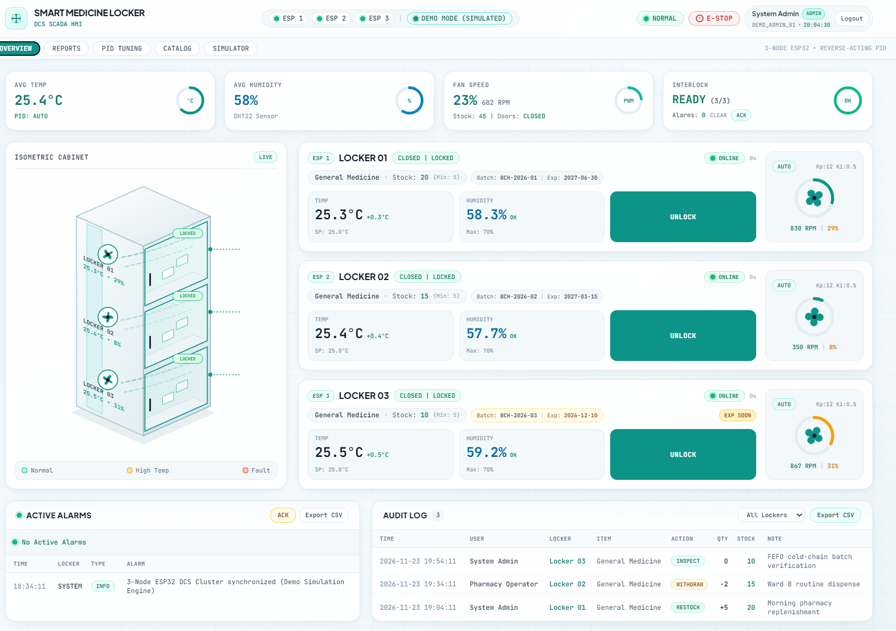
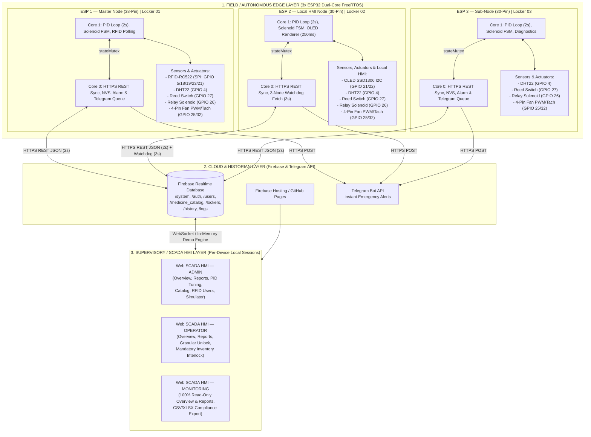

# Smart Medicine Locker — 3-Node ESP32 Distributed Control System (DCS) & Clinical Web SCADA HMI

[](./firmware/smart_medicine_locker_v2/smart_medicine_locker_v2.ino)
[](./firmware/smart_medicine_locker_v2/smart_medicine_locker_v2.ino)
[](./public/js/firebase-config.example.js)
[](./public/index.html)
[](./HARDWARE_SPEC.md)

> **🚀 [Live Interactive Demo](https://wilsonlygh.github.io/smart-medicine-locker/)** *(Runs 100% in your browser via the built-in Virtual Plant Simulation Engine — no physical ESP32 hardware or credentials required!)*  
> 📄 **Hardware & Wiring Documentation:** [`HARDWARE_SPEC.md`](./HARDWARE_SPEC.md) • [`WIRING_AND_PINOUT.md`](./WIRING_AND_PINOUT.md)

---

## 1. Overview

**Smart Medicine Locker** is an industrial-grade **Distributed Control System (DCS)** and **Supervisory Control and Data Acquisition (SCADA)** platform engineered for pharmaceutical cold-chain and controlled-room storage across three independent locker compartments (**Locker 01**, **Locker 02**, and **Locker 03**).

Unlike centralized IoT cabinets that suffer from a single point of failure, each compartment is governed by its own autonomous **ESP32 Edge Controller** running **Dual-Core FreeRTOS**:
- **Core 1 (Real-Time Control & Security Loop):** Executes discrete **Reverse-Acting PID** temperature regulation ($\Delta t = 2.0\text{ s}$) driving a **25 kHz 4-Pin PWM Cooling Fan**, an **IRAM-safe Tachometer ISR** with pulse-width crosstalk filtering, a **4-Stage Non-Blocking Solenoid Finite State Machine (FSM)** with $150\text{ ms}$ door reed switch debouncing, **RFID-RC522** card polling (on `ESP 1`), and **0.96" OLED I2C** local HMI rendering (on `ESP 2`) with zero network blocking.
- **Core 0 (Cloud Historian & Diagnostics Task):** Manages non-blocking HTTPS REST synchronization with **Google Firebase Realtime Database**, **NVS Flash persistence** (`Preferences.h`), a **20-event Store-and-Forward Alarm Ring Buffer**, 5-minute cold-chain compliance snapshots ($288\text{ samples} / 24\text{h}$), and cooldown-protected **Telegram Bot API** emergency alerts.

---

## 2. Visual Showcase

| Physical 3-Node DCS Cabinet & Local OLED HMI | Clinical Light Web SCADA HMI & Isometric Digital Twin |
| :---: | :---: |
|  |  |
| *Place hardware prototype photo at `docs/images/prototype.jpg`* | *Place dashboard screenshot at `docs/images/hmi-dashboard.png`* |

---

## 3. Three-Tier DCS / SCADA System Architecture



---

## 4. Key Engineering Features

### 4.1 Edge Firmware & Real-Time Control (`smart_medicine_locker_v2.ino`)
- **Discrete Reverse-Acting PID Thermal Control:**
  - Computes error $e(k) = PV(k) - SP(k)$ every $\Delta t = 2.0\text{ s}$ (`CONTROL_LOOP_MS = 2000UL`) with default gains $K_p = 12.0$, $K_i = 0.5$, $K_d = 2.0$.
  - Incorporates anti-windup integral clamping ($I(k) \in [0.0, 50.0]$) and deadband cutoff ($u(k) = 0\%$ when $PV \le SP$), outputting an 8-bit duty cycle on a **25 kHz hardware LEDC PWM channel** (`GPIO 25`).
- **Capacitive Crosstalk-Immune Fan Tachometer ISR (`GPIO 32`):**
  - Uses direct register reads (`REG_READ(GPIO_IN1_REG)`) inside an `IRAM_ATTR` `CHANGE` interrupt to measure Hall-sensor LOW pulse width ($\Delta t_{\text{low}} \ge 400\,\mu\text{s}$) and inter-pulse period ($\Delta t_{\text{period}} \ge 6000\,\mu\text{s}$ for $2\text{ PPR}$, $\le 5000\text{ RPM}$), completely rejecting $25\text{ kHz}$ PWM switching noise ($< 40\,\mu\text{s}$) and smoothing RPM via an Exponential Moving Average ($0.35 / 0.65$).
- **4-Stage Non-Blocking Solenoid Finite State Machine (FSM):**
  - Eliminates relay chattering, coil overheating, and Firebase race conditions across four deterministic states:
    1. `LOCK_STATE_LOCKED` (`GPIO 26 = HIGH` / Relay OFF)
    2. `LOCK_STATE_WAIT_OPEN` (`GPIO 26 = LOW` / Relay ON, $10\text{ s}$ wait-open timeout)
    3. `LOCK_STATE_DOOR_OPEN` (`GPIO 26 = LOW` / Relay ON while door is open; automatically de-energizes coil after $10\text{ s}$ max hold while preserving `authorizedDoorOpenActive = true` until physical closure)
    4. `LOCK_STATE_CLOSING_CONFIRM` (`GPIO 26 = LOW` / Relay ON for $2.0\text{ s}$ continuous closed confirmation before relocking)
- **Predictive Maintenance (`FAN FAULT`) & Anti-Glitch Tamper Security (`FORCED ENTRY`):**
  - **`FAN FAULT`:** Triggers when $\text{PWM} > 30\%$ and $\text{RPM} == 0$ continuously for $\ge 5000\text{ ms}$ outside `E-STOP`.
  - **`FORCED ENTRY`:** Requires the raw magnetic reed switch (`GPIO 27`) to remain open continuously for $\ge 500\text{ ms}$ while `LOCK_STATE_LOCKED`, `!authorizedDoorOpenActive`, outside the $3\text{ s}$ boot grace and $2\text{ s}$ post-relock grace windows.
  - **RC522 EMI/Brownout Auto-Recovery:** Periodically audits MFRC522 `VersionReg`, `TxASKReg` (`0x40`), and `TxControlReg` (`0x03`) every $3\text{ s}$ and after relay transitions to automatically re-initialize the SPI reader if inductive spikes disturb the $3.3\text{V}$ rail.
- **True Offline Failsafe (NVS Flash & Store-and-Forward Queue):**
  - Persists 11 operational parameters (`sp`, `kp`, `ki`, `kd`, `mode`, `mpwm`, `max_t`, `max_h`, `med_id`, `stock`, `rfid_uids`) in ESP32 NVS Flash (`"locker_cfg"`).
  - Buffers up to $20$ critical alarm events in a thread-safe RAM ring buffer while offline and flushes them in FIFO order to `/logs/alarms` upon Wi-Fi reconnection.
- **On-Cabinet Local OLED HMI (`ESP 2`, SSD1306 $128\times 64$ I2C):**
  - Monitors all 3 ESP nodes via a **12-second Heartbeat Change Watchdog** (`1:ON 2:ON 3:ON` header) and auto-rotates detailed telemetry slides for **Locker 01**, **Locker 02**, and **Locker 03** every $3\text{ seconds}$ with high-contrast inverted alarm banners.

### 4.2 Clinical Light Web SCADA HMI & Pharmacy Compliance (`public/`)
- **Interactive 3-Tier Isometric Cabinet Digital Twin (Inline SVG):**
  - Live CSS/SVG animations for fan rotor speed, airflow stream opacity/velocity, interior thermal glow (Cool Mint $\rightarrow$ Warm Amber $\rightarrow$ Danger Red), and isometric door swing synchronized with each locker card.
- **100% Per-Device Local Session Isolation & 3-Tier RBAC:**
  - Sessions are stored exclusively in browser `localStorage` (`scada_local_session`) so multiple devices (Admin laptop, Operator tablet, Public monitoring screen) operate concurrently without session collision.
  - Supports **Physical RFID Auto-Login**, **30-Second Admin Scan-to-Fill Card Enrollment** (`/auth/enroll_until`), and **3 Roles** (`ADMIN`, `OPERATOR` with per-locker `L1`/`L2`/`L3` permissions, and 100% Read-Only `MONITORING`) protected by **Anti-Lockout Safety Interlocks**.
- **2-Stage Armed Mandatory Inventory Interlock & FEFO Expiry Enforcement:**
  - Clicking `Unlock` arms Stage 1 (`Waiting for Door...`); Stage 2 opens the non-dismissible **Mandatory Inventory Modal** (`WITHDRAW`, `RESTOCK`, `INSPECT`) only when the physical door opens ($1.5\text{ s}$ auto-simulated in Demo Mode).
  - Enforces **FEFO (First Expired, First Out)** by flagging `< 30 days` (`EXP SOON`) and $\le 0\text{ days}$ (`EXPIRED`), blocking `OPERATOR` withdrawals on expired stock while allowing `ADMIN` override.
- **Live PID Performance Metrics & Excel-Ready Cold-Chain Compliance Reports:**
  - Real-time calculation of **Steady-State Error ($e_{ss}$)**, **Peak Overshoot ($\text{OS}\%$)**, and **Average PWM Cooling Load ($\overline{MV}\%$)**.
  - One-click **Export CSV** (with UTF-8 BOM `\uFEFF`, `sep=,` regional Excel directive, and RFC-4180 quoting) and **Export Excel (`.xlsx`)** (via SheetJS with auto-fitted columns) structured into 3 blocks: *Report Metadata*, *Compliance Summary Table*, and *Detailed Telemetry Log Table*.

---

## 5. Hardware Architecture & Unified Strapping-Safe GPIO Pinout

All three ESP32 nodes share a **single unified firmware codebase** (`firmware/smart_medicine_locker_v2/smart_medicine_locker_v2.ino`) configured via `#define LOCKER_ID` (`1`, `2`, or `3`):

| GPIO Pin | `ESP 1` (38-Pin Master) | `ESP 2` (30-Pin + OLED) | `ESP 3` (30-Pin Node) | Mode / Protocol | Technical Notes |
| :---: | :--- | :--- | :--- | :--- | :--- |
| **`GPIO 4`** | DHT22 Data | DHT22 Data | DHT22 Data | Digital 1-Wire | Temperature ($^\circ\text{C}$) & Humidity ($\%\text{RH}$) sampled every $2.0\text{ s}$ |
| **`GPIO 25`** | 4-Pin Fan PWM | 4-Pin Fan PWM | 4-Pin Fan PWM | LEDC PWM ($25\text{ kHz}$, 8-bit) | Reverse-Acting PID cooling output ($0\text{–}100\%$) |
| **`GPIO 26`** | Relay Solenoid Lock | Relay Solenoid Lock | Relay Solenoid Lock | `OUTPUT` (Active-LOW) | Pre-initialized `HIGH` before `pinMode` to prevent boot unlock glitch |
| **`GPIO 27`** | Magnetic Door Reed | Magnetic Door Reed | Magnetic Door Reed | `INPUT_PULLUP` | `LOW` = Closed, `HIGH` = Open ($150\text{ ms}$ software debounce) |
| **`GPIO 32`** | Fan Tachometer RPM | Fan Tachometer RPM | Fan Tachometer RPM | `INPUT_PULLUP` + ISR `CHANGE` | IRAM-safe register read with $\ge 400\,\mu\text{s}$ pulse-width filter |
| **`GPIO 5`** | RC522 `SDA (SS)` | *(Unused)* | *(Unused)* | Hardware VSPI `CS` | RFID SPI Chip Select (`HAS_RFID = true` on `ESP 1` only) |
| **`GPIO 18`** | RC522 `SCK` | *(Unused)* | *(Unused)* | Hardware VSPI `SCK` | RFID SPI Clock |
| **`GPIO 19`** | RC522 `MISO` | *(Unused)* | *(Unused)* | Hardware VSPI `MISO` | RFID SPI MISO |
| **`GPIO 23`** | RC522 `MOSI` | *(Unused)* | *(Unused)* | Hardware VSPI `MOSI` | RFID SPI MOSI |
| **`GPIO 21`** | RC522 `RST` | OLED I2C `SDA` | *(Unused)* | `OUTPUT` (ESP 1) / I2C `SDA` (ESP 2) | Compile-time `#error` guard prevents simultaneous `HAS_RFID` & `HAS_OLED` |
| **`GPIO 22`** | *(Unused)* | OLED I2C `SCL` | *(Unused)* | Hardware I2C `SCL` | SSD1306 $128\times 64$ I2C Clock (`0x3C` / fallback `0x3D`) |

---

## 6. Quick Start & Installation Guide

### A. Running the Web SCADA HMI in Interactive Demo Mode (Zero Configuration)
If `public/js/firebase-config.js` is absent, contains template placeholders, or the URL includes `?demo=true`, the application automatically boots into **Interactive Demo Mode** using an in-memory RTDB adapter and a $1.5\text{ s}$ virtual plant engine:

```bash
# Serve the public/ directory with any static HTTP server:
npx serve public
# Open http://localhost:3000 (or http://localhost:3000/?demo=true)
```

On the Login Page, click **`Launch Demo (Admin)`** or **`Launch Demo (Operator)`** for instant 1-click access.

### B. Connecting to Production Firebase RTDB & Hosting
1. Copy the Firebase configuration template and fill in your Firebase project credentials:
   ```bash
   cp public/js/firebase-config.example.js public/js/firebase-config.js
   ```
2. Edit `public/js/firebase-config.js` (this file is gitignored and never committed) with your `window.FIREBASE_CONFIG` keys.
3. Deploy to Firebase Hosting:
   ```bash
   npx firebase-tools@latest deploy --only hosting
   ```

### C. Flashing the 3-Node ESP32 Edge Firmware
1. Copy the firmware credentials template to `secrets.h` (gitignored):
   ```bash
   cp firmware/smart_medicine_locker_v2/secrets.example.h firmware/smart_medicine_locker_v2/secrets.h
   ```
2. Edit `firmware/smart_medicine_locker_v2/secrets.h` with your `SECRET_WIFI_SSID`, `SECRET_WIFI_PASSWORD`, and `SECRET_FIREBASE_HOST`.
3. Open `firmware/smart_medicine_locker_v2/smart_medicine_locker_v2.ino` in **Arduino IDE** (with `esp32 by Espressif Systems` core and libraries: `DHT sensor library`, `MFRC522`, `ArduinoJson`, `Adafruit SSD1306`, `Adafruit GFX Library`).
4. Set `#define LOCKER_ID` on line 29 to `1` for **ESP 1 (Master + RFID)**, `2` for **ESP 2 (OLED HMI)**, or `3` for **ESP 3**, and upload to each board.

---

## 7. Repository Structure

```text
scada-medicine-locker/
├── .github/workflows/
│   └── pages.yml                       # Auto-deploy public/ to GitHub Pages (Interactive Demo Mode)
├── docs/images/                        # Hardware prototype & HMI screenshots
├── firmware/smart_medicine_locker_v2/
│   ├── smart_medicine_locker_v2.ino    # Unified Dual-Core FreeRTOS firmware for ESP 1, ESP 2 & ESP 3
│   ├── secrets.example.h               # Sanitized Wi-Fi & Firebase RTDB credentials template
│   └── secrets.h                       # Local credentials (Ignored by Git)
├── public/
│   ├── index.html                      # Clinical Light Web SCADA HMI (Single-Page Application)
│   ├── css/hmi.css                     # Glassmorphism, ISA-18.2 alarm animations & @media print styles
│   └── js/
│       ├── app.js                      # SCADA controller, RBAC, PID charts, Excel export & Demo Engine
│       ├── firebase-config.example.js  # Sanitized frontend Firebase config template
│       └── firebase-config.js          # Local production Firebase config (Ignored by Git)
├── HARDWARE_SPEC.md                    # System & hardware specification
├── WIRING_AND_PINOUT.md                # GPIO pinout & inductive flyback protection wiring guide
└── README.md                           # Project portfolio documentation
```
