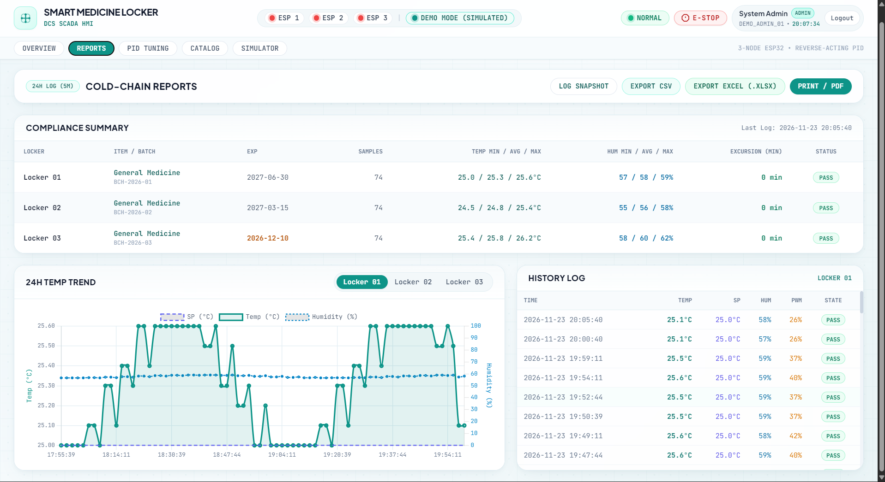
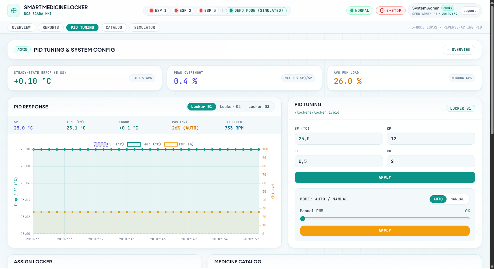
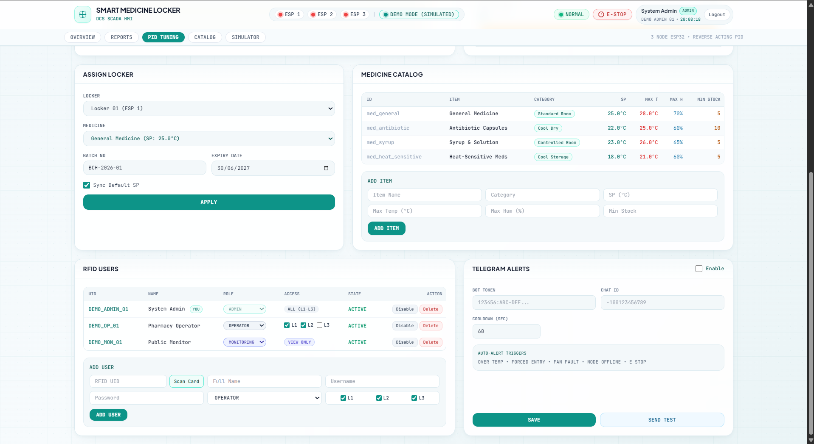
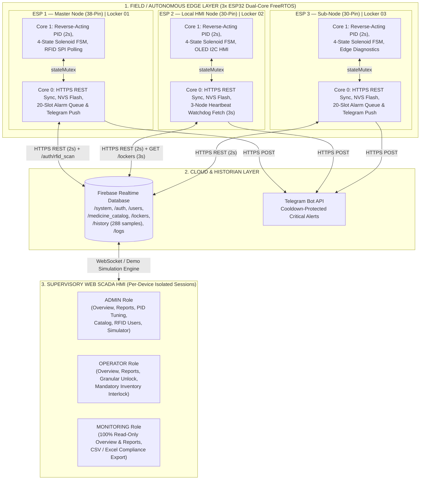

# Smart Medicine Locker — 3-Node ESP32 Distributed Control System (DCS) & Web SCADA HMI

[](https://wilsonlygh.github.io/smart-medicine-locker/)
[](./firmware/smart_medicine_locker_v2/smart_medicine_locker_v2.ino)
[](./firmware/smart_medicine_locker_v2/smart_medicine_locker_v2.ino)
[](./public/js/firebase-config.example.js)
[](./public/js/app.js)
[](./HARDWARE_SPEC.md)
[](./public/index.html)

**Smart Medicine Locker** is an industrial-style **Distributed Control System (DCS)** and **Web SCADA Human-Machine Interface (HMI)** engineered for pharmaceutical cold-chain and controlled-room storage across three independent compartments (**Locker 01**, **Locker 02**, and **Locker 03**). Each compartment is governed by a dedicated **Dual-Core FreeRTOS ESP32 Edge Controller** executing real-time **Reverse-Acting PID** PWM cooling, a **4-Stage Solenoid Finite State Machine (FSM)**, predictive fan-fault diagnostics, and NVS offline failsafe operation, synchronized in real time with a **Clinical Light Web SCADA HMI**.

---

## 🚀 Live Interactive Demo (Zero Hardware Required)

Experience the full Web SCADA HMI directly in your browser powered by a client-side **1.5-second Virtual Plant Simulation Engine**:

### 👉 **[Launch Live Interactive SCADA Demo](https://wilsonlygh.github.io/smart-medicine-locker/)**

**Quick 1-Click Recruiter Walkthrough:**
1. Open the **[Live Demo Link](https://wilsonlygh.github.io/smart-medicine-locker/)** — no credentials or physical ESP32 hardware required.
2. On the Login screen, click **`Launch Demo (Admin)`** (full PID tuning, catalog, RBAC & fault simulator access) or **`Launch Demo (Operator)`** (standard pharmacy dispense workflow).
3. Click **`Unlock`** on any locker card to test the **2-Stage Armed Inventory Interlock**: the status transitions to `Waiting for Door...`, automatically simulates the physical door opening after $1.5\text{ s}$, and launches the **Mandatory Inventory Audit Modal**.
4. Explore **`Reports`** (24-hour cold-chain trend & 1-click CSV / Excel `.xlsx` compliance export), **`PID Tuning`** (live $e_{ss}$, Peak Overshoot, and Auto/Manual fan PWM control), **`Catalog`** (FEFO expiry tracking & 3-tier RBAC), and **`Simulator`** (fault injection test bench).

---

## 🖼️ Visual Showcase

### 1. Main SCADA Overview & Interactive 3-Tier Isometric Digital Twin

*Real-time supervisory dashboard featuring the interactive 3-tier isometric cabinet SVG (live fan rotation, airflow streams, thermal glow, and door states), KPI summary ring gauges, per-locker telemetry cards with circular fan PWM/RPM dials, ISA-18.2 active alarm management, and transaction audit trail.*

### 2. Cold-Chain Compliance Reports & 24-Hour Telemetry Historian

*Automated 5-minute cold-chain compliance historian ($288\text{ samples} / 24\text{h}$ per locker) with Min/Avg/Max temperature & humidity statistics, excursion duration tracking (`PASS` / `EXCURSION`), multi-axis 24H trend chart, and structured 3-block **Export CSV** & **Export Excel (`.xlsx`)**.*

### 3. Real-Time Reverse-Acting PID Tuning & Live Control Metrics

*Live multi-axis PID response monitor plotting Setpoint ($SP$), Process Variable ($PV$), and Fan PWM Output ($MV\%$) alongside real-time control performance metrics: **Steady-State Error ($e_{ss}$)**, **Peak Overshoot ($\text{OS}\%$)**, and **Average PWM Cooling Load**, plus remote $K_p, K_i, K_d$ tuning and `AUTO` / `MANUAL` override.*

### 4. Medicine Catalog (FEFO), 3-Tier RBAC User Management & Telegram Alerts

*Pharmaceutical preset catalog with automatic setpoint synchronization, batch & FEFO expiry assignment, granular 3-role RBAC table (`ADMIN`, `OPERATOR` with per-locker `L1`/`L2`/`L3` checkboxes, and 100% Read-Only `MONITORING`) with RFID Scan-to-Fill card enrollment, and cooldown-protected Telegram Bot alert configuration.*

---

## 🏗️ System Architecture & Engineering Highlights

### Three-Tier DCS / SCADA Architecture



### Key Engineering Highlights

1. **Autonomous 3-Node DCS & Dual-Core FreeRTOS Separation:**
   - **Core 1** executes deterministic local control loops (DHT22 acquisition, tachometer ISR, PID computation, solenoid FSM, RC522 SPI polling, and SSD1306 I2C display rendering) completely isolated from network latency.
   - **Core 0** (`16 KB` stack) handles TLS/HTTPS REST synchronization, NTP timekeeping, **NVS Flash persistence (`Preferences.h`)**, and a **20-event Store-and-Forward RAM ring buffer** that queues critical alarms while offline and flushes them in FIFO order upon reconnection.
2. **Discrete Reverse-Acting PID & Crosstalk-Filtered Fan Tachometer:**
   - Computes cooling error $e(k) = PV(k) - SP(k)$ every $\Delta t = 2.0\text{ s}$ with anti-windup integral clamping ($I(k) \in [0, 50]$) and deadband cutoff ($u(k) = 0\%$ when $PV \le SP$), driving a **25 kHz 8-bit hardware LEDC PWM** channel (`GPIO 25`).
   - An `IRAM_ATTR` `CHANGE` interrupt on `GPIO 32` performs direct register reads (`REG_READ(GPIO_IN1_REG)`) to validate Hall-sensor LOW pulse width ($\ge 400\,\mu\text{s}$) and period ($\ge 6000\,\mu\text{s}$), eliminating $25\text{ kHz}$ PWM capacitive crosstalk spikes.
3. **4-Stage Non-Blocking Solenoid Lock FSM & $150\text{ ms}$ Reed Debounce:**
   - Prevents relay chattering, coil overheating, and Firebase race conditions across four states: `LOCK_STATE_LOCKED` $\rightarrow$ `LOCK_STATE_WAIT_OPEN` ($10\text{ s}$ timeout) $\rightarrow$ `LOCK_STATE_DOOR_OPEN` ($10\text{ s}$ max coil hold while keeping `authorizedDoorOpenActive = true` until physical closure) $\rightarrow$ `LOCK_STATE_CLOSING_CONFIRM` ($2.0\text{ s}$ continuous closed confirmation before relocking).
4. **Edge Predictive Maintenance (`FAN FAULT`) & Anti-Glitch Tamper Security (`FORCED ENTRY`):**
   - **`FAN FAULT`:** Triggers if $\text{PWM} > 30\%$ while $\text{RPM} == 0$ continuously for $\ge 5.0\text{ s}$ outside `E-STOP`.
   - **`FORCED ENTRY`:** Requires continuous uncommanded magnetic reed switch opening for $\ge 500\text{ ms}$ outside authorized unlock sessions and post-relock ($2\text{ s}$) / post-boot ($3\text{ s}$) grace windows, rejecting transient mechanical vibrations and EMI glitches.
5. **3-Tier RBAC, Per-Device Session Isolation & Pharmacy Audit Compliance:**
   - Sessions are isolated per browser via `localStorage` (`scada_local_session`), supporting physical **RFID Auto-Login**, **30-second Admin Scan-to-Fill Card Enrollment**, and inline role management (`ADMIN`, `OPERATOR`, `MONITORING`) with anti-lockout safety guards.
   - Enforces a **2-Stage Mandatory Inventory Interlock Modal**, **FEFO expiry rules** (blocking Operator withdrawals on expired stock), and **Excel-ready CSV (UTF-8 BOM + `sep=,`) & `.xlsx` reports**.

---

## 🛠️ Tech Stack Summary

| Layer | Technologies & Components | Primary Responsibilities |
| :--- | :--- | :--- |
| **Hardware & Actuators** | 1× ESP32 38-Pin (`ESP 1`), 2× ESP32 30-Pin (`ESP 2`, `ESP 3`), 3× DHT22, 1× MFRC522 RFID (SPI), 1× SSD1306 0.96" OLED (I2C), 3× Magnetic Reed Switches, 3× Active-LOW Relays + 12V Solenoid Locks (with 1N4007 flyback diodes), 3× 4-Pin 12V PWM Fans, 12V PSU + 5.0V–5.2V Buck Converter | Distributed sensing, forced-air PWM cooling, electromechanical locking, physical RFID authentication, and on-cabinet local OLED status display |
| **Control & Edge Firmware** | C++ / Arduino (ESP32 Core), Dual-Core FreeRTOS (`xTaskCreatePinnedToCore`, `SemaphoreHandle_t`), Discrete Reverse-Acting PID, 4-State Solenoid FSM, `Preferences.h` (NVS Flash), `ArduinoJson`, `MFRC522`, `Adafruit_SSD1306` | Real-time thermal control, pulse-width filtered RPM measurement, offline failsafe persistence, store-and-forward alarm buffering, and 12s heartbeat watchdog |
| **Cloud & Telemetry** | Google Firebase Realtime Database (REST API & Modular WebSocket SDK v10.14.1), Firebase Hosting, GitHub Pages (CI/CD via GitHub Actions), Telegram Bot API, NTP (`pool.ntp.org`) | Real-time state synchronization, 5-minute cold-chain historian ($288\text{ samples} / 24\text{h}$ sliding window), RBAC audit logging, and instant mobile alerts |
| **Web SCADA HMI** | Semantic HTML5, Tailwind CSS, Custom Clinical Light CSS (`@media print` & ISA-18.2 alarm animations), Vanilla ES6 JavaScript, Inline Interactive Isometric SVG, Chart.js, SheetJS (`xlsx.full.min.js`), Web Audio API | Supervisory control, animated 3-tier digital twin, live PID tuning & performance metrics, mandatory inventory interlock, and CSV/Excel compliance exports |

---

## 📂 Documentation & Public Repository Structure

- **Hardware & System Specification:** [`HARDWARE_SPEC.md`](./HARDWARE_SPEC.md)
- **GPIO Pinout & Inductive Protection Wiring Guide:** [`WIRING_AND_PINOUT.md`](./WIRING_AND_PINOUT.md)

```text
smart-medicine-locker/
├── .github/workflows/
│   └── pages.yml                       # GitHub Actions CI/CD workflow for GitHub Pages Live Demo
├── docs/images/
│   ├── hmi-dashboard.png               # Main SCADA Overview & 3-tier isometric cabinet digital twin
│   ├── hmi-trend.png                   # Cold-Chain Compliance Reports & 24H telemetry historian
│   ├── hmi-pid-tuning.png              # Real-time PID response chart & live control performance metrics
│   └── hmi-catalog.png                 # Medicine catalog (FEFO), 3-tier RBAC & Telegram alerts
├── firmware/smart_medicine_locker_v2/
│   ├── smart_medicine_locker_v2.ino    # Unified modular Dual-Core FreeRTOS firmware (ESP 1, ESP 2, ESP 3)
│   └── secrets.example.h               # Sanitized Wi-Fi & Firebase RTDB credentials template
├── public/
│   ├── index.html                      # Clinical Light Web SCADA HMI single-page application
│   ├── css/hmi.css                     # Clinical glassmorphism, ISA-18.2 alarm flashing & print styles
│   └── js/
│       ├── app.js                      # SCADA controller, RBAC, PID charts, Excel export & Demo Engine
│       └── firebase-config.example.js  # Sanitized frontend Firebase configuration template
├── firebase.json                       # Firebase Hosting configuration
├── HARDWARE_SPEC.md                    # System architecture & hardware specification
├── WIRING_AND_PINOUT.md                # Unified strapping-safe GPIO pinout & flyback protection guide
└── README.md                           # Project portfolio documentation
```

---

## ⚡ Local Setup & Quick Start

### 1. Run in Interactive Demo Mode (No Firebase or ESP32 Required)
When `public/js/firebase-config.js` is absent, contains template placeholders, or the URL includes `?demo=true`, the Web HMI automatically runs in **Interactive Demo Mode**:

```bash
git clone https://github.com/WilsonLyGH/smart-medicine-locker.git
cd smart-medicine-locker
npx serve public
```
Open `http://localhost:3000` (or `http://localhost:3000/?demo=true`) and click **`Launch Demo (Admin)`** or **`Launch Demo (Operator)`**.

### 2. Connect to Your Own Firebase Realtime Database
1. Copy the frontend Firebase configuration template:
   ```bash
   cp public/js/firebase-config.example.js public/js/firebase-config.js
   ```
2. Open `public/js/firebase-config.js` (automatically ignored by `.gitignore`) and replace the placeholder values in `window.FIREBASE_CONFIG` with your Firebase Web App credentials.

### 3. Flash the 3-Node ESP32 Edge Firmware
1. Copy the firmware credentials template:
   ```bash
   cp firmware/smart_medicine_locker_v2/secrets.example.h firmware/smart_medicine_locker_v2/secrets.h
   ```
2. Edit `firmware/smart_medicine_locker_v2/secrets.h` (automatically ignored by `.gitignore`) with your `SECRET_WIFI_SSID`, `SECRET_WIFI_PASSWORD`, and `SECRET_FIREBASE_HOST`.
3. Open `firmware/smart_medicine_locker_v2/smart_medicine_locker_v2.ino` in **Arduino IDE** (`ESP32 Dev Module`) with `DHT sensor library`, `MFRC522`, `ArduinoJson`, `Adafruit SSD1306`, and `Adafruit GFX Library` installed.
4. Set `#define LOCKER_ID` (line 29) to `1` (`ESP 1` Master + RFID), `2` (`ESP 2` + OLED HMI), or `3` (`ESP 3`), and upload to each board.
